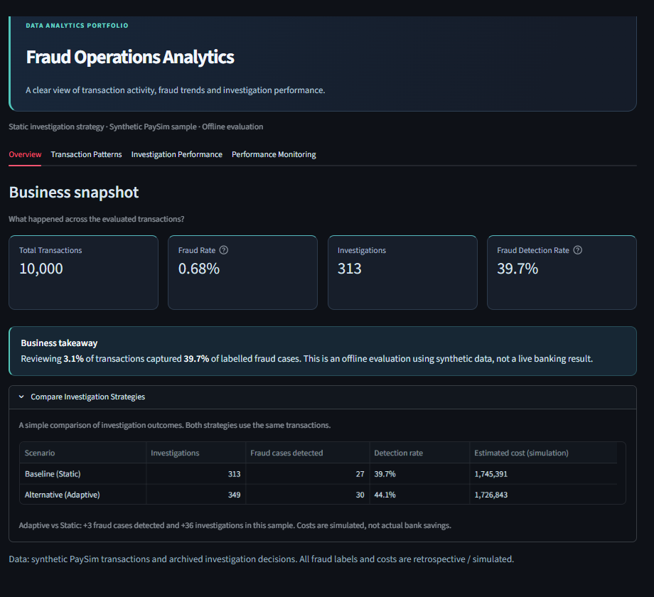
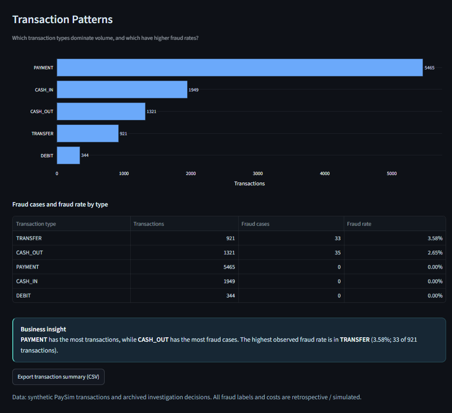
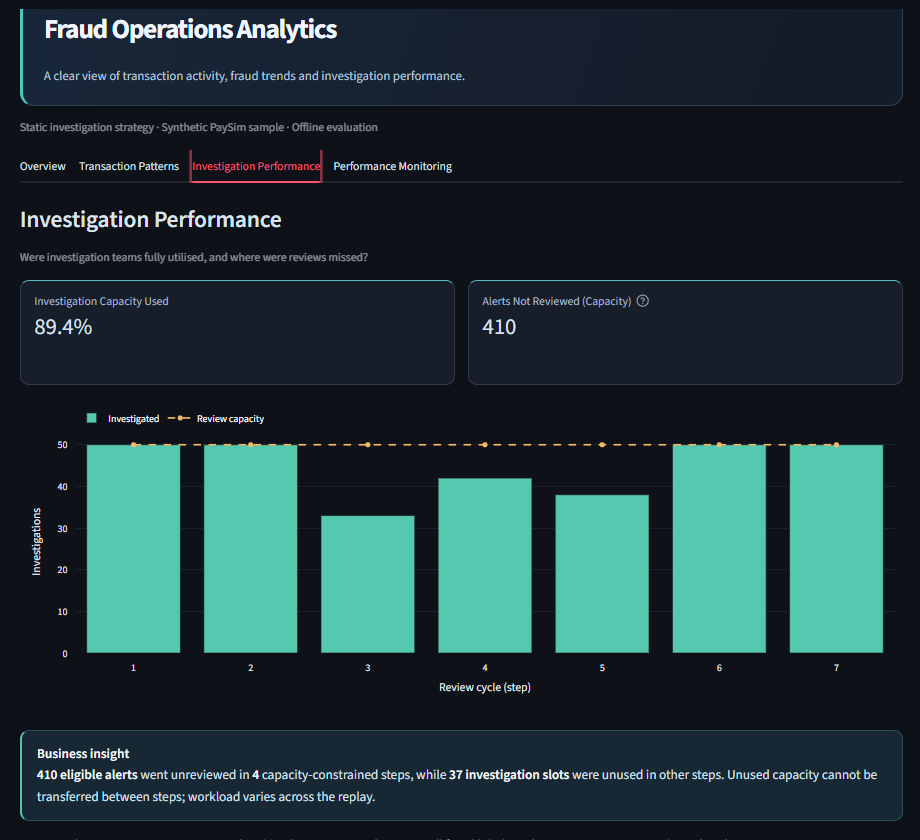
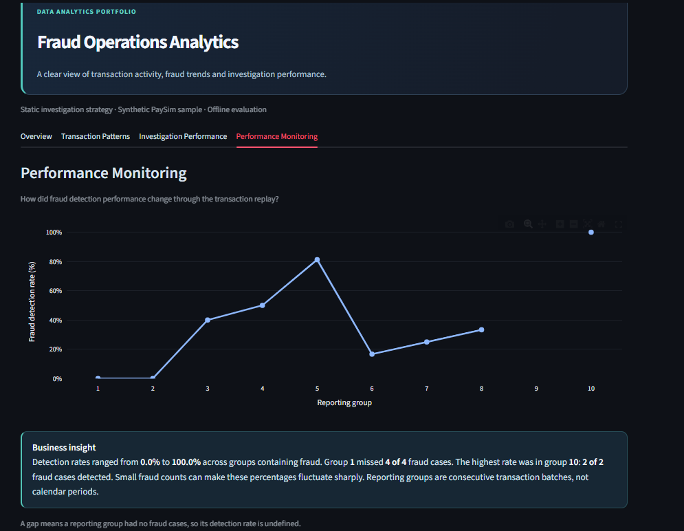
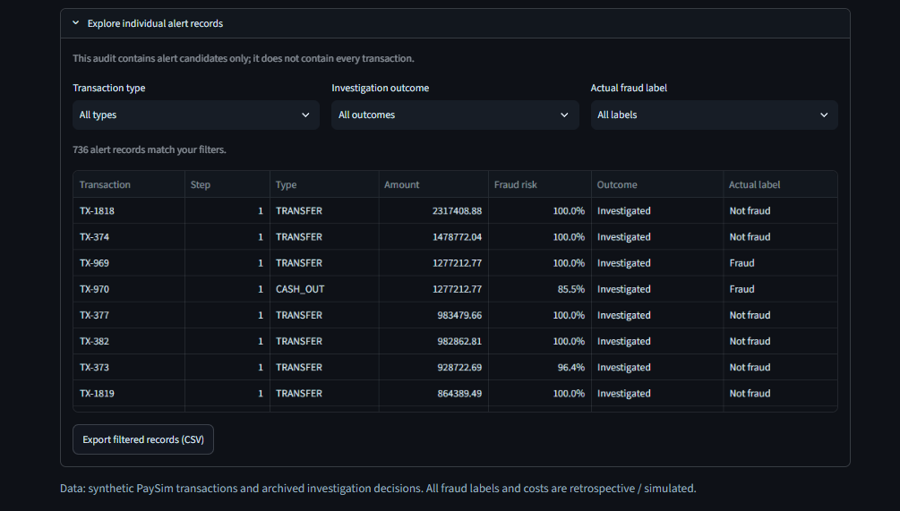

# Fraud Operations Analytics

**SQL · Python · SQLite · pandas · Streamlit · Plotly**  
*Data Analyst portfolio project | Fraud patterns, operational KPIs and reporting*

A business-focused dashboard that analyses **synthetic payment transactions** and **simulated fraud-investigation results**. It turns raw reporting data into clear answers about transaction activity, where fraud occurs, investigation workload and changes in detection performance.

The focus of this repository is **data analytics and business reporting**, not model training. Investigation outcomes are imported from the separate [Decision-Centric Fraud Framework](https://github.com/alice-patrick/decision-centric-fraud-framework).

## Key findings from a 10,000-transaction sample

- **Fraud detection:** 313 investigations identified **27 of 68** labelled fraud cases (**39.7% detection rate**), while reviewing **3.1%** of transactions in the Static baseline.
- **Transaction patterns:** `PAYMENT` accounted for the most transactions (**5,465**), but `TRANSFER` had the highest observed fraud rate (**3.58%**, or 33 of 921 transactions).
- **Operational workload:** **410** eligible alerts were not investigated because capacity was full in four review steps, while **37** review slots went unused in other steps. Unused slots could not be transferred between steps in this simulation.

**Reported scenario:** 10,000 synthetic transactions; **50 review slots per operational step**; 3-step repeat-alert suppression; €10 assumed review cost; Static threshold 0.50; Adaptive risk floor 0.30 and budget multiplier 1.40. These are observations from an **offline, saved simulation scenario**, not real-world banking performance or realised savings. The **current importer defaults to 30 slots per step**; importing again with the default settings may produce different counts. The sample and model version also affect reproducibility.

## Dashboard

### 1. Overview — the business snapshot

A concise view of transaction volume, fraud rate, investigations and detection performance. An optional comparison shows the **Static baseline** alongside the **Adaptive alternative**, without making model mechanics the focus.



### 2. Transaction Patterns — where fraud is concentrated

Explores transaction volume and the difference between **fraud counts** and **fraud rates** across payment types. Includes a downloadable transaction summary.



### 3. Investigation Performance — where capacity is constrained

Shows review capacity by operational step and highlights where alerts were left uninvestigated. The emphasis is on understanding workload and identifying operational bottlenecks.



### 4. Performance Monitoring — how results change

Tracks fraud detection rates across **consecutive transaction groups**, not calendar periods. Insights include the actual fraud counts behind percentages to avoid misleading interpretations of small samples.



<details>
<summary><strong>Additional view: Filterable investigation records</strong></summary>

The dashboard also provides transaction-type, investigation-outcome and actual-label filters, plus a CSV export of the selected alert records.



</details>

## Skills demonstrated

| Area | Application in this project |
| --- | --- |
| **SQL & SQLite** | CTEs, `JOIN` / `LEFT JOIN`, grouped aggregations, `ROW_NUMBER()` and cumulative `SUM() OVER (...)` for reporting |
| **Data preparation & validation** | Python/pandas import of structured API results, consistency checks and six SQLite reporting tables |
| **Business analysis** | Fraud-rate comparisons, investigation workload, capacity utilisation and evidence-based insights |
| **Data visualisation** | Streamlit dashboard, Plotly charts, interactive filters and CSV exports |

**SQL examples in the actual implementation:** [fraud patterns — `LEFT JOIN` and grouped aggregation](dashboards/thesis_decision_dashboard.py#L56-L79) · [investigation workload — CTEs and cumulative `SUM() OVER`](dashboards/thesis_decision_dashboard.py#L80-L108) · [transaction audit — `ROW_NUMBER()`](dashboards/thesis_decision_dashboard.py#L109-L125).

The reporting queries and dashboard are in [`dashboards/thesis_decision_dashboard.py`](dashboards/thesis_decision_dashboard.py); the validated import is in [`scripts/import_from_thesis_api.py`](scripts/import_from_thesis_api.py).

## Data flow

**Main Framework sequential results** → FastAPI JSON → Python validation/import → **SQLite and SQL reporting** → Streamlit dashboard.

The [Main Framework](https://github.com/alice-patrick/decision-centric-fraud-framework) generates the risk scores and investigation decisions. This repository **analyses the saved results**, without retraining the model or rerunning decision logic.

## Run locally

**Windows / Command Prompt** — from this Analytics repository:

```cmd
py -m venv .venv
.venv\Scripts\activate.bat
python -m pip install -r requirements.txt
python -m streamlit run dashboards\thesis_decision_dashboard.py
```

Open **http://localhost:8501**. When `data/processed/fraud_investigation.db` already holds the imported sequential results, the Main API does **not** need to be running to view the dashboard.

**First-time import (SQLite database missing):** start the Main Framework API in its own project folder with its model and PaySim data available:

```cmd
python -m uvicorn app.api.main:app --host 127.0.0.1 --port 8002
```

Then, in the Analytics repository, import and launch the dashboard:

```cmd
.venv\Scripts\activate.bat
python scripts\import_from_thesis_api.py --api-url http://127.0.0.1:8002
python -m streamlit run dashboards\thesis_decision_dashboard.py
```

If your Main API uses **8003**, substitute that port in the importer command. The current importer's default scenario uses **30 review slots per step**, so new imports may not match the **50-slot archived results** pictured above. Importing stores the results in a local SQLite file, which is **not included in this GitHub repository**.

## Scope

This is a **portfolio and research prototype**, based on synthetic PaySim transactions and offline sequential simulation. Fraud labels are retrospective, and estimated costs depend on simplified assumptions. It is **not** a live bank-monitoring or production fraud-detection system.
