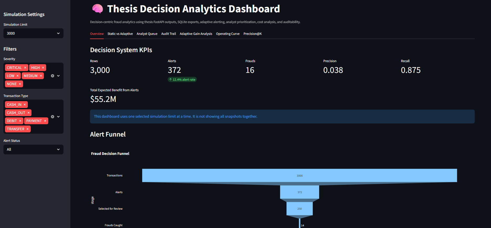
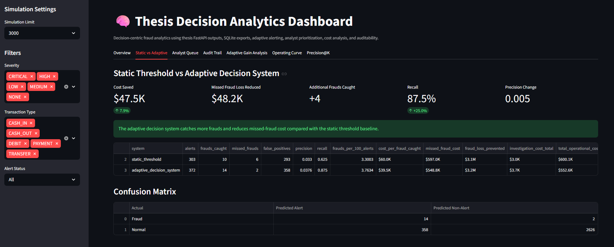
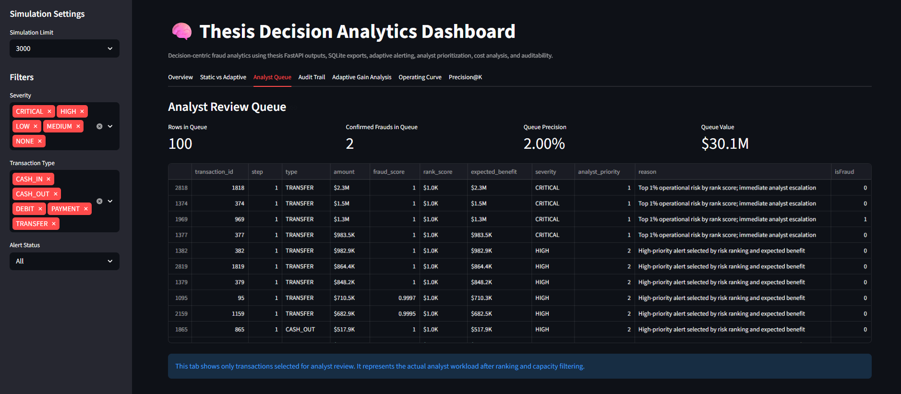
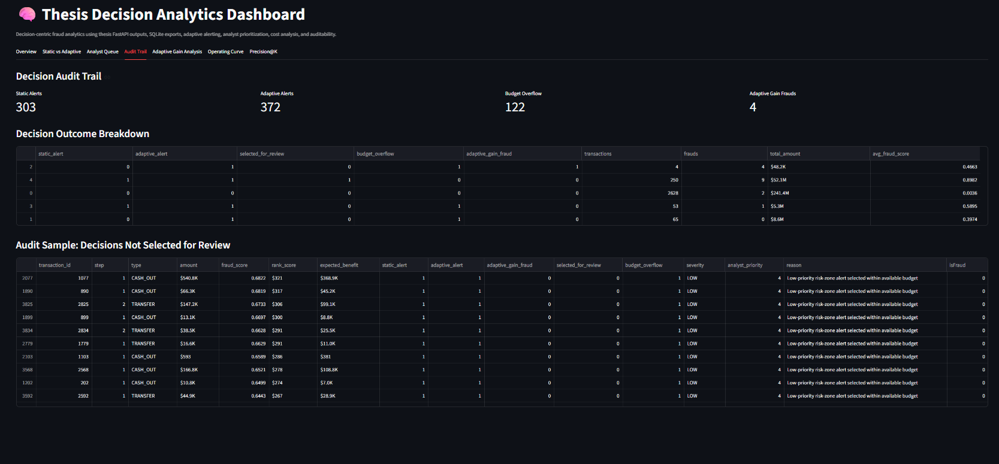
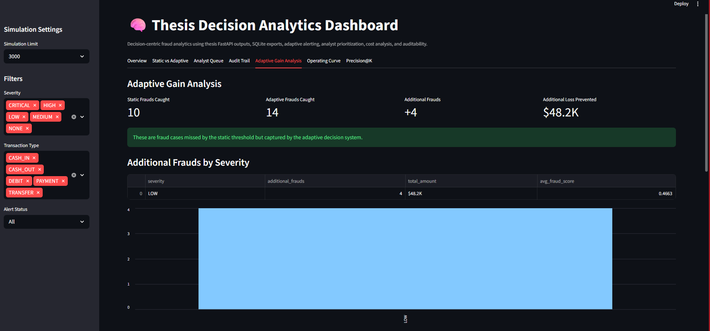
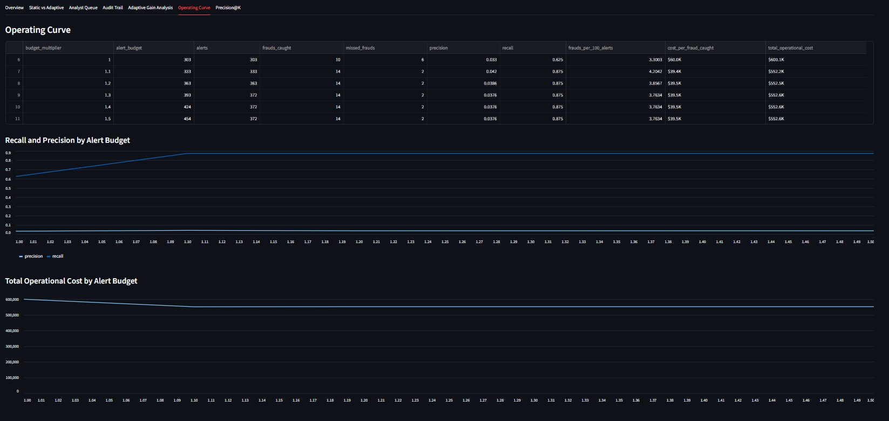
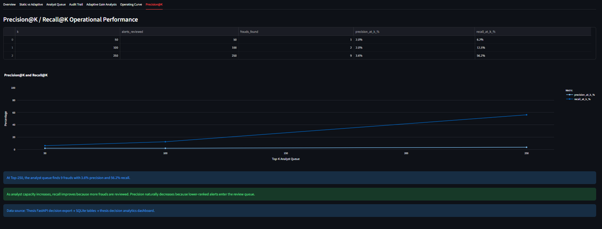

<<<<<<< HEAD
# Fraud Decision Analytics

**Fraud Operations Analytics & Decision Support**  
**SQL · Python · Pandas · SQLite · Streamlit · Plotly · KPI Reporting**

A Data Analyst portfolio project that examines how fraud investigation strategies affect detection coverage, analyst workload and estimated operational cost. Using synthetic PaySim transactions, it turns recorded simulation outputs into validated SQL reports, interactive dashboards and business findings.

## One project, two repositories

| Component | Responsibility |
| --- | --- |
| **[Analytics Dashboard](https://github.com/alice-patrick/fraud-decision-analytics)** — this repository | Imports results, validates data quality, queries SQLite and reports KPIs, workload, outcomes and trends |
| **[Main Framework](https://github.com/alice-patrick/decision-centric-fraud-framework)** | Generates model scores and Static/Adaptive sequential investigation decisions using Python, ML and FastAPI |

**Data flow:** Main `GET /simulation/sequential` → validated SQLite snapshot → SQL reporting → Streamlit dashboard.

The Analytics layer reports recorded decisions. It does not train models, rescore transactions, change priorities or reconstruct simulations. Selecting Static or Adaptive changes the reporting view only.

## Business question

With limited investigation capacity, how do Static and Adaptive policies trade off fraud coverage, review effort and modeled missed-fraud exposure?

### Baseline findings

The illustrated run evaluates **10,000 transactions with 68 actual frauds**, a capacity of **50 investigations per operational step**, an assumed **€10 review cost**, and repeat-alert suppression over **3 steps**. Static threshold: 0.50; Adaptive risk floor: 0.30; budget multiplier: 1.40.

| KPI | Static | Adaptive |
| --- | ---: | ---: |
| Investigations | 313 | 349 |
| Frauds detected | 27 | 30 |
| Frauds missed | 41 | 38 |
| Non-fraud reviews | 286 | 319 |
| Recall | 39.7% | 44.1% |
| Precision | 8.6% | 8.6% |
| Estimated operational cost | €1,745,391.01 | €1,726,843.29 |

- **Coverage:** Adaptive detects 3 additional frauds, increasing recall by approximately 4.4 percentage points.
- **Workload:** This requires 36 additional investigations — 12 extra reviews per additional detected fraud. Non-fraud reviews increase by 33.
- **Modeled cost:** Total cost falls by €18,547.72 under the stated assumptions, while rounded precision remains approximately unchanged.
- **Capacity:** Static uses 313 of 350 available slots across seven steps, yet rejects 410 eligible candidates. Unused slots in one step cannot absorb demand in another.

**Recommendation:** In this baseline, Adaptive offers greater coverage and lower modeled cost if the additional review workload is acceptable. Investigate step-level capacity pressure before proposing more capacity. One scenario does not establish universal policy superiority or the effect of a capacity change; scenario evaluation belongs to the Main Framework.

Costs combine investigation spend and a modeled transaction-amount proxy for missed-fraud exposure. They are **simulation estimates, not realized banking savings**. Currency formatting follows the project's hypothetical monetary convention.

## Dashboard walkthrough

Static appears first and is selected by default. A shared sidebar policy selector controls all four views; the policy comparison always keeps Static before Adaptive.

### 1. Overview

Business KPIs, a compact outcomes comparison, separate cost-component charts and a concise interpretation of coverage/workload trade-offs. Small nonzero rate differences retain their sign instead of rounding to a misleading zero.


### 2. Analyst Capacity

Shows investigation utilisation, steps at capacity, unused slots and rejected candidates. The prioritised queue can be filtered by operational step, transaction type, decision outcome and risk range.


The decision inspector explains the Main's recorded outcome using its original priority rank and capacity counters. Ground-truth fraud labels are excluded from the operational queue; they are used retrospectively in the audit.


### 3. Audit Trail

Filter recorded candidates by transaction type, outcome, step and actual fraud label, then export the filtered audit to CSV.


Below the table, a conserved transaction-flow diagram links transaction types to investigated, suppressed and capacity-rejected outcomes. Investigated alerts split into detected fraud and non-fraud reviews. Choose **All transactions** for full-population context or **Candidate alerts only** to inspect smaller decision flows.

The type filter applies to both the table and diagram. Step, outcome and actual-label filters apply only to the candidate table: the Main's full-population transaction-type summaries are available at run level.

### 4. Monitoring

A monitoring window is a consecutive group of replay transactions, usually 1,000 records. It is not a fixed time interval. Capacity resets at an operational step, not at a reporting-window boundary; a step can span multiple windows.


Choose a KPI to inspect changes across the original Main windows. Hover reveals replay positions and step spans. Insights highlight weak coverage/yield or elevated workload/cost, with the underlying counts. Undefined rates appear as gaps. Replay positions identify ordered records, not transaction IDs.

Screenshots illustrate the baseline interface; the current version also includes the candidate-flow selector and revised monitoring insights described above.

## SQL skills demonstrated

These queries drive the reports, rather than serving as disconnected examples. Source: [`dashboards/thesis_decision_dashboard.py`](dashboards/thesis_decision_dashboard.py), also available through the dashboard's **SQL methodology** panel.

| Query | Techniques | Analytical purpose |
| --- | --- | --- |
| `SQL_OVERVIEW` | CTE, JOIN, LEFT JOIN, conditional aggregation | Reconcile summary KPIs with candidate decisions |
| `SQL_TYPE_ANALYSIS` | CTE, LEFT JOIN, GROUP BY | Connect full transaction-type populations to decision outcomes |
| `SQL_STEP_WORKLOAD` | CTE, LEFT JOIN, ROW_NUMBER, cumulative SUM OVER | Include zero-alert steps, rank workload and track investigations |
| `SQL_AUDIT` | ROW_NUMBER with PARTITION BY | Inspect within-step score ordering using the Main's tie-breaking rules |
| `SQL_MONITORING` | Bound run/policy filters, ordered reporting | Retrieve original monitoring-window records |

Run and policy filters use SQLite parameters. SQL score rank is an analytical audit field; it does not replace the Main's recorded candidate priority or final decision.

## Data quality and limitations

- Both policies share an imported run identity and the original simulation settings.
- Candidates, investigations, suppression and capacity rejection reconcile against the audit.
- Fraud counts, rates, cost components and type/step/window totals are checked before reporting.
- Failed validation or staged imports preserve the previous database; dashboard queries are read-only.
- PaySim data is synthetic; replay is offline; investigation and suppression assumptions are simplified.
- Fraud labels support retrospective evaluation and were unavailable when the simulated decisions were made.

This repository demonstrates SQL, Python/Pandas, data quality and reporting. It does not currently contain an Excel workbook or Power BI report.

## Run locally

Requires **Python 3.10+**. From this repository's root:

```bash
python -m pip install -r requirements.txt
python -m streamlit run dashboards/thesis_decision_dashboard.py
```

For the first import, start the Main Framework API using its README. Enter its local address in the dashboard import form, for example `http://127.0.0.1:8002` or port `8003`, and select **Import sequential results**.

Alternatively:

```bash
python scripts/import_from_thesis_api.py --api-url http://127.0.0.1:8002
```

Default import sizes are 1,000, 3,000 and 10,000 transactions. To choose sizes:

```bash
python scripts/import_from_thesis_api.py --api-url http://127.0.0.1:8002 --limits 1000 3000 10000 50000
```

The matching Main endpoint must export complete decision rows, policy summaries, transaction-type summaries, operational steps and monitoring windows. Older batch tables cannot drive this sequential dashboard. Importing creates `data/processed/fraud_investigation.db`; no populated database is included in the update bundle.

## Repository structure

```text
fraud-decision-analytics/
├── dashboards/thesis_decision_dashboard.py
├── scripts/import_from_thesis_api.py
├── data/processed/                 # generated reporting database
├── docs/images/                    # dashboard screenshots
├── tests/                          # SQL/import/reporting checks and fixtures
├── .streamlit/config.toml
├── .github/workflows/analytics-checks.yml
├── requirements.txt
└── README.md
```

## Verification

```bash
python -m unittest discover -s tests -v
```

Checks cover SQL reconciliation, policy isolation, zero-candidate runs, ranking ties, failed-import recovery, KPI differences, queue filters, decision explanations, flow conservation and monitoring boundaries. With Streamlit installed, AppTest also exercises reporting selection and missing-data behavior. The included workflow runs the suite on push and pull requests.

Small frozen fixtures are deterministic test inputs generated from the Main sequential functions. They are never substituted for dashboard reporting data.
=======
# Fraud Decision Analytics

SQLite-based decision analytics dashboard for evaluating adaptive fraud alerting outputs generated by the Adaptive Fraud Intelligence system.

## Overview

This project focuses on decision monitoring and operational evaluation of fraud investigation workflows.

The dashboard allows analysts to explore:

* Static Threshold vs Adaptive Decision System performance
* Fraud recall and precision comparisons
* Analyst queue effectiveness
* Precision@K and Recall@K evaluation
* Operating curve analysis
* Audit trail monitoring
* Cost-aware fraud investigation metrics

Unlike traditional fraud dashboards that focus only on model scores, this project evaluates how decision strategies affect operational outcomes.

---

## Relationship to the Main Thesis Project

This repository is a companion analytics project for:

**Adaptive Fraud Intelligence**

**Main Thesis Repository:**
https://github.com/alice-patrick/adaptive-fraud-intelligence

The main system generates fraud decisions and investigation outputs.

This repository focuses on analyzing those outputs through an interactive Streamlit dashboard.

---

## Objective

This dashboard evaluates the operational impact of adaptive fraud decision strategies by measuring investigation efficiency, fraud recall, analyst workload, and cost-aware alert prioritization.

---

## Dashboard Screenshots

### Dashboard Overview



The main dashboard provides a consolidated view of decision-centric fraud analytics, including system performance metrics, analyst prioritization, cost analysis, and operational monitoring.

#### Additional Dashboard Views

.png)

.png)

Additional dashboard pages provide deeper operational visibility into decision outcomes, investigation workflows, fraud prioritization, and monitoring metrics.

---

### Static vs Adaptive Decision System


.png)

Compare a traditional static-threshold approach against the adaptive decision engine and evaluate improvements in fraud detection performance and operational efficiency.

---

### Analyst Queue Monitoring



Monitor alert prioritization and analyst workload distribution. This view demonstrates how adaptive ranking strategies affect investigation capacity and queue composition.

---

### Audit Trail



Review investigation outcomes and decision history to improve transparency, traceability, and operational accountability.

---

### Adaptive Gain Analysis


.png)

Measure the operational benefits generated by adaptive alert selection compared with static alerting strategies.

---

### Operating Curve Analysis


.png)

Evaluate how investigation budget and analyst capacity influence recall, precision, and total operational cost.

---

### Precision@K and Recall@K



Analyze fraud detection effectiveness across different analyst review capacities using Precision@K and Recall@K evaluation metrics.

---

## Dashboard Features

### Decision System Comparison

Compare:

* Static Threshold Strategy
* Adaptive Decision Strategy

Metrics:

* Precision
* Recall
* Alerts Generated
* Frauds Caught
* Total Operational Cost

### Operating Curve Analysis

Evaluate different operating points based on investigation capacity and alert budgets.

### Analyst Queue Monitoring

Analyze:

* Alert prioritization
* Queue composition
* Investigation workload

### Precision@K Analysis

Measure how analyst review capacity impacts fraud detection performance.

### Audit Trail Monitoring

Review investigation outcomes and decision system behavior.

---

## Example Use Cases

* Compare static and adaptive fraud alerting strategies
* Analyze analyst review capacity using Precision@K
* Evaluate operational costs under different alert budgets
* Monitor fraud investigation performance through audit trails
* Support decision-centric fraud operations research

---

## Project Structure

```text
fraud-decision-analytics/
├── dashboards/
│   └── thesis_decision_dashboard.py
├── scripts/
│   └── import_from_thesis_api.py
├── data/
│   └── processed/
├── docs/
│   └── images/
├── README.md
├── requirements.txt
└── .gitignore
```

---

## Installation

```bash
pip install -r requirements.txt
```

---

## Run Dashboard

```bash
streamlit run dashboards/thesis_decision_dashboard.py
```

---

## Technology Stack

* Python
* Streamlit
* Pandas
* SQLite
* Plotly

---

## Key Concepts

* Decision Intelligence
* Fraud Analytics
* Analyst Prioritization
* Cost-Aware Investigation
* Operational Monitoring
* Precision@K Evaluation
* Adaptive Alerting

---

## License

MIT License
>>>>>>> e16c0a173e16163d2c65866941d1f71a53df4f55
